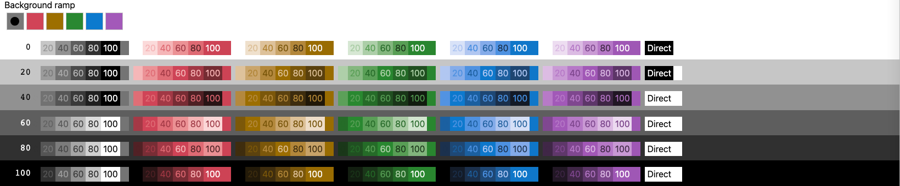
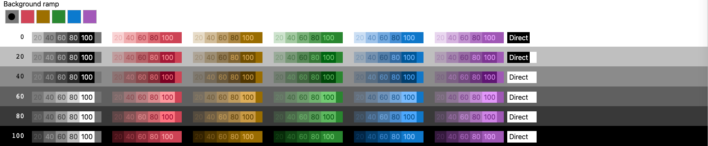
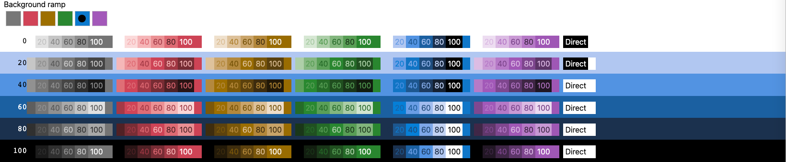
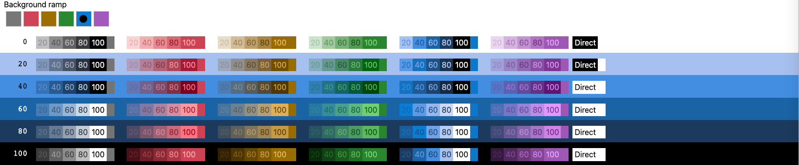

# Color Contrast: relative semantic scaling

The prior implementation is committed at `71f59a1`. This correction changes the legacy `Color.contrast()` signal path used by the Color Contrast demo. Page markup, layout, control labels, and settings are unchanged. The standalone `huet/core` still uses its earlier contrast-target solver; the relative semantic rule is being evaluated in the requested legacy demo first.

## Diagnosis

Two independent problems explain the middle columns:

- A mandatory 4.5:1 target on middle gray leaves almost no room for chroma. Semantic borders/text converge toward black or white.
- Searching a saturated signal ramp at low contrast picks a color near the background's lightness without reducing its chroma. A 12-strength fill can acquire far more than 12% of the intended color.
- The measured-ratio branch bypassed `startSignalLightness` and `endSignalLightness`. Their controls still updated configuration, but that branch did not use it.

The four columns are relative requests 0, 49, 51, and 100, not fixed absolute gray percentages. With the current neutral solver and a white root, the middle backgrounds resolve to `#777777` and `#747474`. Changing the root changes those backgrounds.

## One path, one strength

1. Choose one light/dark direction from the background's contrast against the primary endpoints. All hues share it.
2. Sample each signal ramp at its existing lightness setting. This is the full-strength anchor on the corresponding black/white endpoint.
3. Express that anchor's OKLab lightness distance as a fraction of the primary range. Apply that same fraction to the available distance from the current background toward the chosen endpoint.
4. Retain the anchor's hue/chroma, reducing chroma only to fit sRGB.
5. Interpolate **all three OKLab channels** from the background to that adapted anchor by `strength × contrastMultiplier`.

For example, a 12-strength submit fill travels 12% of the same path whose endpoint supplies the 100-strength border. It no longer jumps to full saturation. At black and white, full strength reproduces the configured anchor exactly for the default palette.

A polarity guard handles unusual custom anchors and rounding without allowing one hue to reverse direction. Identical primary endpoints return the background.

## Existing settings

- **Signal Lightness on 'Black'** (`endSignalLightness`): the ramp position of the full-strength anchor when going lighter.
- **Signal Lightness on 'White'** (`startSignalLightness`): the ramp position of the full-strength anchor when going darker.
- **Contrast**: the distance traveled along the same path.
- Disabling contrast rescaling retains the old unnormalized path.

No additional setting is needed. For a minimal future API, retain color anchors and strength; these two legacy lightness settings are compatibility controls, not a recommendation to add more knobs.

## Tradeoff and evidence

This policy prioritizes recognizable semantic hue and proportional strength. It does **not** guarantee WCAG 4.5:1 for small semantic text or 3:1 for every colored border. At root 100%, measured semantic contrasts in the two middle columns are about **2.81–2.96:1** and **2.48–2.65:1**. Neutral text still uses the existing measured-contrast solver. This is an explicit policy change, not a claim that hue-preserving mid-gray text now satisfies the previous ratio guarantee.

Screenshots use identical 2000px browser viewports and the unmodified four-column form:

| Root background | Before | After |
| --- | --- | --- |
| 100% | [before](screenshots/contrast-100-before.png) | [after](screenshots/contrast-100-after.png) |
| 75% | [before](screenshots/contrast-75-before.png) | [after](screenshots/contrast-75-after.png) |
| 25% | [before](screenshots/contrast-25-before.png) | [after](screenshots/contrast-25-after.png) |
| 0% | [before](screenshots/contrast-0-before.png) | [after](screenshots/contrast-0-after.png) |

The before captures came from an isolated archive of `71f59a1`. [Raw rendered colors and ratios](screenshots/contrast-measurements.json) accompany the after images.

Validation: 31 unit/integration tests, six Chromium browser tests, TypeScript, and the library build pass. Added checks verify hue/chroma in all four form columns at all four root settings, 12% perceptual travel for fills, shared direction on normal/inverted ramps, endpoint preservation, and actual rendered responses to both lightness sliders. The existing tests also verify no validation backgrounds were added.

## Deferred issue

The neutral gray Submit button remains visually uneven in light, middle-gray, and dark modes. This predates the semantic-ramp correction and is intentionally deferred; the next ramp fix must not change the neutral algorithm or demo markup.

## Near-black spacing and monotonic progression checkpoint

The next correction keeps the semantic anchors and OKLab paths, but spaces strength by **proportional contrast**, using `ratio(amount) = ratio(anchor) ** amount`. It finds the closest quantized color on that same path. This supersedes the raw 12% OKLab-distance rule above: small steps on black no longer round almost to black, and zero/full strength remain unchanged. The contrast target is derived from the chosen anchor, not a mandatory accessibility threshold.

The neutral solver now also chooses its direction once per background. Previously it could choose a dark sample for one strength and a light sample for the next. Every increasing-strength sequence now stays on one side and progresses monotonically. This shared algorithm correction also affects neutral submit fills; no button-specific style or tuning was added.

Tests sweep all integer strengths across 101 backgrounds for gray and all five semantic hues, check low-step visibility on black against white, and measure proportional contrast for rendered submit fills. Earlier screenshots above document the prior checkpoint; [the near-black matrix before this correction](screenshots/ramp-black-before.png) records the newly reported failure.

## Neutral overlays on colored background ramps

When the chosen background ramp was colored, requesting the separate gray ramp fell through to the old ramp-sampling code. That immediately discarded the background hue (including at strength zero). The non-root neutral ramp now follows the same proportional-contrast OKLab mixing path as semantic overlays, from the actual background to the selected neutral endpoint. Its light/dark direction is shared with the background's other colors.

Zero strength preserves the exact background; intermediate strengths retain its tint; full strength reaches the neutral endpoint. This does not change the root-ramp solver, semantic signal solver, direct ramps, or page markup. Custom non-root "furthest" ramps follow the same endpoint rule; disabling contrast rescaling retains the legacy behavior.

Coverage checks all five colored background ramps, several ramp positions, monotonic progression, endpoint behavior, and zero global contrast. A browser regression checks the actual gray cells in row 20 for every colored background selection. [Blue-background matrix after the fix](screenshots/ramp-blue-neutral-after.png).

## Matching-ramp spacing in rows 40 and 60

When the requested ramp was also the selected background ramp, it still used the original absolute targets (3:1 at 25, 4.5:1 at 50, 21:1 at 100). A middle-tone background cannot provide 21:1. It reached the endpoint early, flattening the rest of the ramp into repeated colors.

That path now uses `availableContrast ** strength`, choosing samples on the configured ramp in the shared direction. Equal strength increments consume equal fractions of the available log-contrast range. Zero preserves the background and 100 reaches the strongest endpoint; intermediate steps no longer require impossible absolute ratios. This supersedes the earlier legacy 25/50 role guarantees. It does not change the standalone core's role targets.

Regression tests check six distinct steps and normalized contrast spacing in the matching column, including actual rows 40 and 60 for gray and blue. Unit coverage also checks all six background ramps from both light and dark roots. [Gray matrix](screenshots/ramp-gray-spacing-after.png) · [Blue matrix](screenshots/ramp-blue-spacing-after.png).

Validation: 36 unit/integration tests, eight Chromium browser tests, TypeScript, and library build pass. No page markup changed.

## Stable global contrast

The global Contrast slider previously changed every intermediate background before choosing its children's light/dark direction. An ancestor crossing the direction boundary could therefore flip a leaf abruptly while dragging the slider.

For global contrast between zero and one, derived colors now resolve against an enabled (full-contrast) reference tree, then share a linear-light fade toward that tree's starting background. Because both parent and child use the same fade origin, their luminance difference scales by the slider value instead of changing sign. At zero they merge into the background; at one the existing palette is unchanged. Intermediate values deliberately follow this common fade rather than recalculating each local ramp. Explicitly constructed starting colors establish their own fade origin.

Reference state follows nested `contrast()`, `direct()`, and `base()` calls, even when two different colors round to the same displayed hex. This adds no configuration, animation, or demo markup. Changing the actual background or theme can still change the enabled palette's direction; this correction concerns the global contrast multiplier.

Regression coverage sweeps nested colors through all 101 slider values and drives the rendered form slider in both directions. Quantized RGB values are allowed small rounding differences. Validation: 38 unit/integration tests, nine Chromium browser tests, TypeScript, and library build.

## Preset roles on narrow ramps and colored surfaces

`theme.tokens()` (and the `--huet-foreground`, `--huet-muted` and `--huet-border` variables `mountTheme` writes on each surface) aimed for 7, 4.5 and 3:1, each capped at the background's available contrast. Orange Boost's ramp (`#474b56` to `#ff7c49`) offers at most 3.4:1, so all three clamped to the endpoint or close to it. A slider's track (border) and its filled part (text) became the same orange. On colored surfaces, the roles were sampled from the neutral ramp and came out gray, such as `#787878` borders on Base's light blue `huet-bg-blue-25`.

The roles now step from the actual background toward the endpoint the text uses. Neutral backgrounds on the ramp follow the ramp, as `huet-surface-N` does. Colored backgrounds use a straight OKLab mix, as nested preset surfaces and non-root neutral overlays already do, so borders and muted text keep the surface's hue. Explicit-amount classes are unchanged: `huet-text-60` on a blue surface still samples the gray ramp.

Where a background reaches 4.5:1, the WCAG targets stay as they were. Below 4:1, each role takes the same share of the foreground's log-contrast that it has at 7:1 (`available ** (ln 4.5 / ln 7)` for muted, `ln 3 / ln 7` for border), as the matching-ramp solver above does for strengths. Between 4 and 4.5:1 the two blend, so dragging the configurator doesn't make the roles jump. Muted text and borders also stay on the text's side of the background; previously a mid-gray surface could get white text with a near-black muted color. A border can still cross to the other side when that's the only way to reach its target against both the surface and its parent, so it keeps outlining the surface.

Unit tests cover the Orange Boost ramp and its blue surface, polarity on three ramps, the outline fallback, smoothness through the blend, and tinting on blue surfaces in Base, Base Inverted and Orange Boost.

## PR comparison: ramp squares

Matched Color Contrast matrix captures use the Base theme, full global contrast, 20-point steps, and a 2000×1100 Chromium viewport. The crop includes the background-ramp picker and all matrix rows, excluding forms and the theme sidebar. Gray and blue selections are captured independently.

Before is the PR base `c77e701ba5261a0d95ab80332eee078cc9602235`; after is implementation `679df34a846e28e6d3cf61ffa472039a9a09a0b8`. These are full-branch comparisons, distinct from the earlier intermediate-checkpoint form screenshots.

| Background ramp | Before | After |
| --- | --- | --- |
| Neutral (gray) |  |  |
| Blue |  |  |

Reproduce by serving the baseline checkout separately, then running `HUET_BEFORE_URL=http://127.0.0.1:8734/ npx playwright test tests/ramp-screenshots.spec.ts`. The screenshot test starts the current implementation on port 8733 and uses fresh browser contexts for both revisions. It is skipped in normal test runs unless the baseline URL is supplied.
