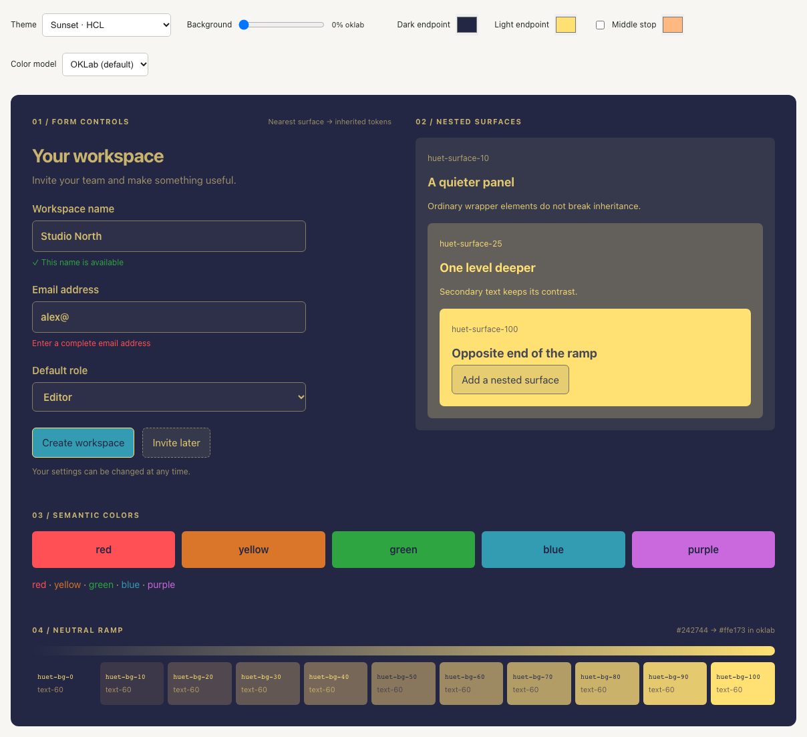
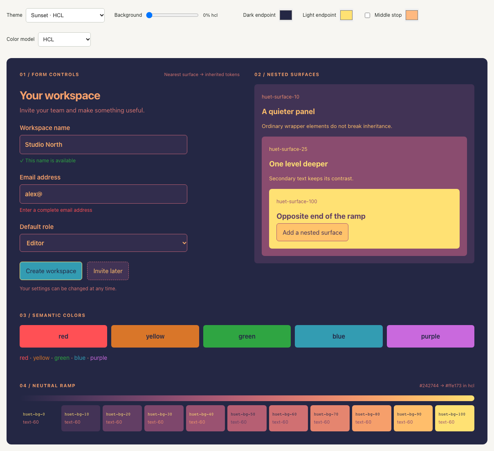
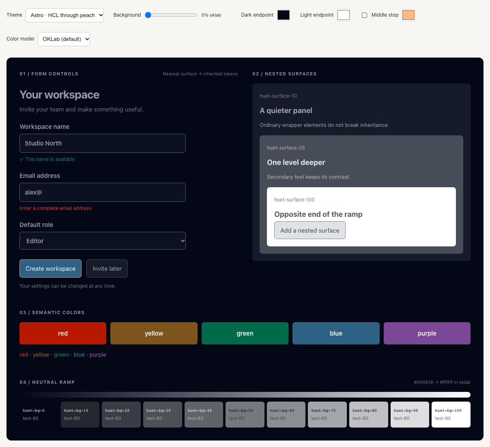
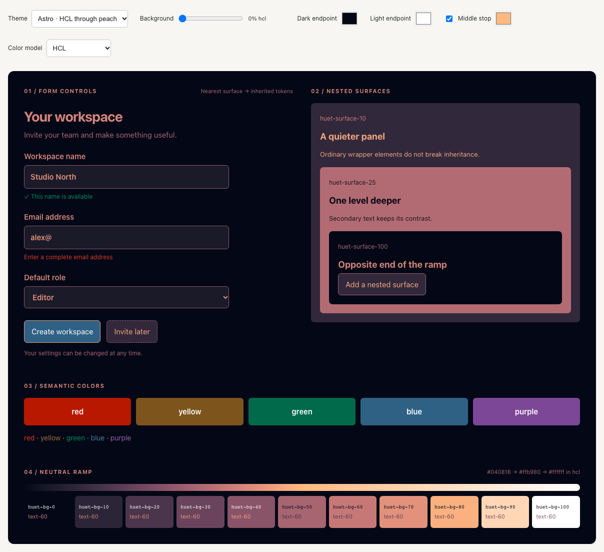

# Multi-hue ramps

The original React themes Sunset and Astro use `colorModel: "hcl"` on their gray ramp. That lets the neutral surfaces pass through several hues instead of fading straight from one endpoint to the other. Since 2019, Astro's ramp has also had a middle stop: `colors: ["black", "gray", "white"]`, where `gray` is the peach `#ffb980`. `huet/core` mixed only `dark` and `light`, and only in OKLab, so neither theme could be expressed. `createTheme` now accepts a `neutral` ramp in the same shape as the legacy `ramps.gray`:

```ts
createTheme({ neutral: { colors: ["#242744", "#ffe173"], colorModel: "hcl" } }); // Sunset
createTheme({ neutral: { colors: ["#040816", "#ffb980", "#ffffff"], colorModel: "hcl" } }); // Astro
```

For Sunset, all of the hue shift comes from the color model. For Astro, most of it comes from the peach stop, which HCL blends into smoothly. Leaving that stop out gives a blue-gray ramp (`#040816 → #3d3f48 → #787a80 → #b9babe → #ffffff`).

## What changes

- **Background position.** `background: t` samples the ramp at `t` in the chosen model, passing through any middle stops.
- **Explicit neutral classes.** `huet-bg-N`, `huet-text-N`, `huet-border-N`, `huet-outline-N`, and their `bg/` forms use the same `Color.contrast()` solver as before. Its neutral ramp is now built from `neutral.colors` in the chosen model. Strength still spaces steps by available contrast, and direction is still chosen once per background, so progressions stay monotonic.
- **Preset tokens and surfaces.** `foreground`, `muted`, and `border` are chosen from samples of the same ramp. `huet-surface-N` moves along the ramp when its parent lies on it. Otherwise it falls back to the straight OKLab mix.
- **Unchanged.** Semantic hues keep their own anchors and contrast rules. Themes created with `dark`/`light` reproduce the previous output exactly (covered by a unit test).

## Screenshots

These are lab demo captures (`/lab.html`) at a 1280px viewport. **Before** is the same preset with the color model set to the OKLab default and the middle stop turned off, which is all `huet/core` could express previously. **After** is the preset as shipped. Sections 01–03 use the existing markup. Section 04 is a row of `huet-bg-0` … `huet-bg-100` swatches above the ramp's gradient.

| Theme | Before (OKLab, endpoints only) | After (HCL) |
| --- | --- | --- |
| Sunset |  |  |
| Astro |  |  |

To regenerate the screenshots, run `HUET_DOCS_SCREENSHOTS=1 npx playwright test tests/color-models.spec.ts`. Without the variable, the spec still checks the midtone chroma and the Astro middle stop.

## Tradeoffs

Hue-based models keep midtones saturated, which is the point for these themes. White and black have no hue, so a ramp segment ending at one keeps the other stop's hue and only fades its chroma. Astro's peach-to-white half never swings through an unrelated hue. A ramp through a light middle stop can be lighter in the middle than OKLab would be. Contrast-based choices (which endpoint is "furthest", readable nudging for preset surfaces) still measure actual luminance. For example, a 25% Astro surface is pink enough that its strongest contrast is back toward the dark end.
