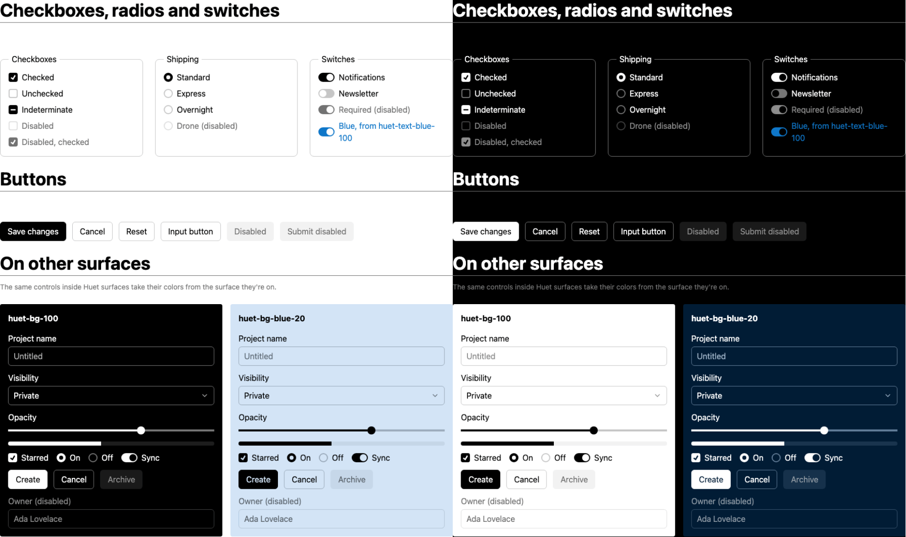
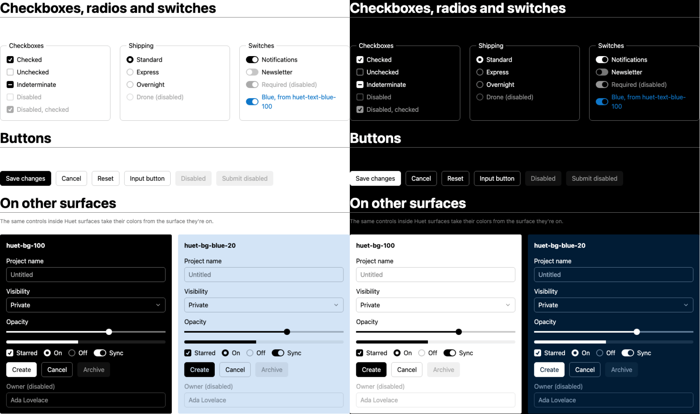
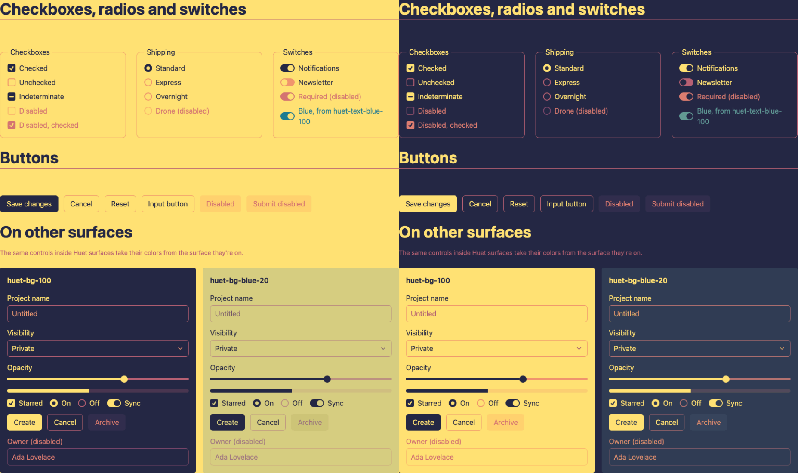
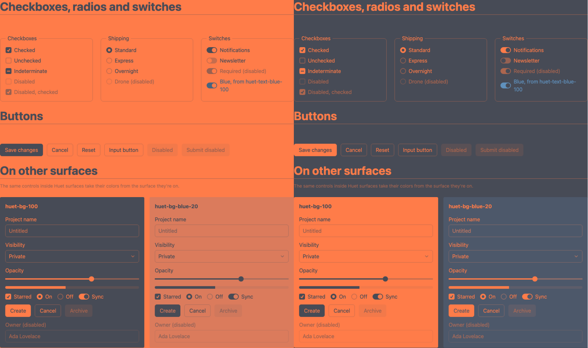
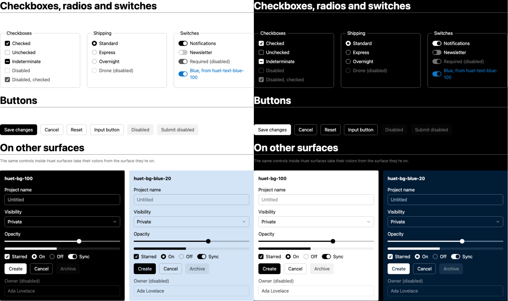
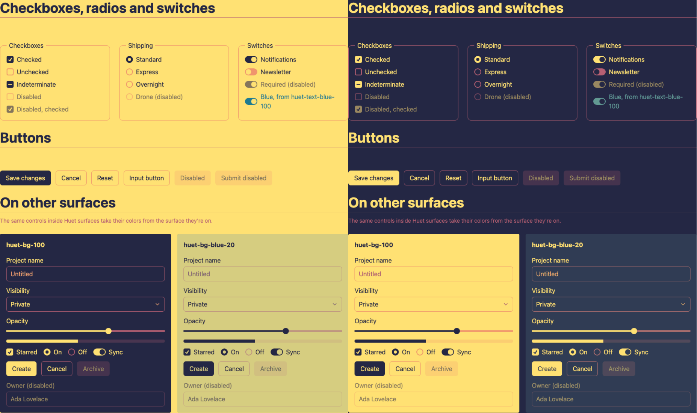
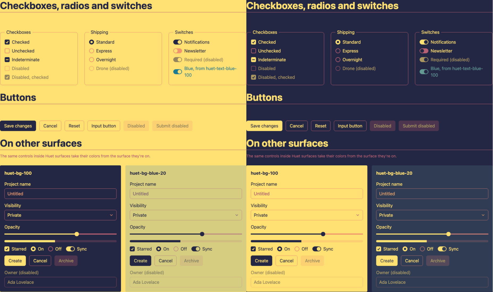
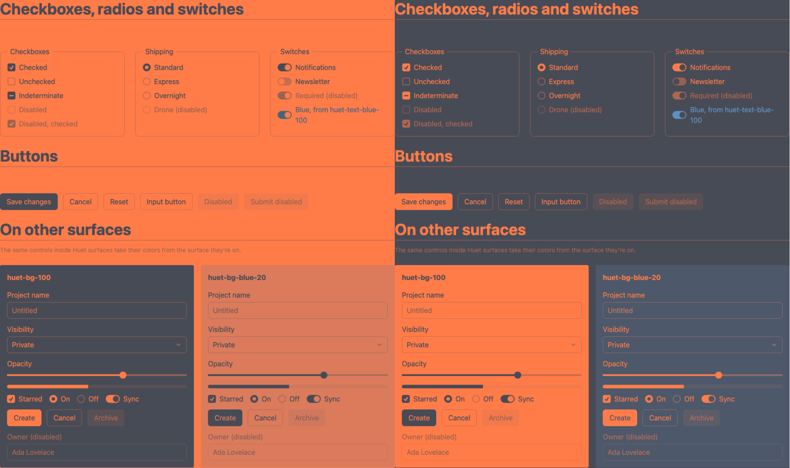
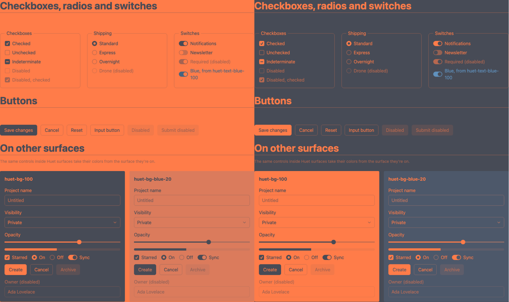

# Disabled controls on light and dark surfaces

`huet/forms.css` used to fade disabled controls by mixing their colors 55% over the background in sRGB. Text was `color-mix(in srgb, currentColor 55%, var(--huet-background))`, lines mixed `--huet-border` the same way, and disabled buttons got a flat fill of `color-mix(in srgb, var(--_line) 40%, var(--huet-background))`. Measured in APCA, that fades dark surfaces much more than light ones: black text on white kept Lc 72.9 of 106 (69%), white text on black kept Lc 40.6 of 107.9 (38%).

Disabled colors now come from the solver, next to `--huet-muted` and `--huet-border`. `mountTheme` and `themeCss` write two more role colors on every surface:

| Variable | Target | Base on white | Base on black |
| --- | --- | --- | --- |
| `--huet-foreground` | Lc 90 | `#4a4a4a` (Lc 90.3) | `#e4e4e4` (Lc 90.4) |
| `--huet-muted` | Lc 60 | `#8e8e8e` (Lc 60.1) | `#b1b1b1` (Lc 60.1) |
| `--huet-disabled` (new) | Lc 45, half the foreground's | `#ababab` (Lc 45.3) | `#959595` (Lc 45.1) |
| `--huet-border` | Lc 30 | `#c7c7c7` (Lc 30.1) | `#767676` (Lc 30.1) |
| `--huet-disabled-border` (new) | Lc 15, half the border's | `#e1e1e1` (Lc 15.2) | `#535353` (Lc 15.3) |

Like the other roles, they step from the surface toward the text's endpoint, keep a colored surface's hue, and keep their proportions on narrow ramps: where a surface can't reach Lc 90, disabled text gets half of what it can reach. Disabled buttons fill with `--huet-5`, the surface's 5 step, which is 5% of the L\* distance to the endpoint on either side.

## What changed for users

- Disabled text is Lc 45 on both polarities. It sits halfway between muted text (Lc 60) and borders (Lc 30), so it no longer reads like a hint. In light mode it's lighter than before (`#737373` → `#ababab` on white). In dark mode it's a little brighter (`#8c8c8c` → `#959595` on black).
- Disabled lines are Lc 15 on both polarities. On white that's about what it was (Lc 15.8 → 15.2). On black it nearly doubles (Lc 8.8 → 15.3).
- Disabled button fills are ΔL\* 5 on both polarities, up from 4.2 on white and down from 9.3 on black. (APCA reads both as below Lc 7.3, so fills are measured in L\*, like other strengths.)
- A disabled control with a `huet-border-*` class now gets the neutral disabled line instead of a faded copy of its own color.
- A disabled slider's filled part (Lc 45) stays stronger than its track (Lc 15). A control inside a disabled `<label>` or `<fieldset>` inherits the label's color, so it isn't faded twice.
- CSS written by an older `themeCss` lacks the new variables. There, `forms.css` falls back to the old 55% sRGB mix.

## Before: a 55% mix in sRGB

Each image is light (background 1) on the left and dark (background 0) on the right. Each side shows the page, an inverted `huet-bg-100` surface and a `huet-bg-blue-20` surface. The Forms page's "On other surfaces" cards now include a disabled button and field.

| Theme | Before | After: solver variables |
| --- | --- | --- |
| Base |  |  |
| Sunset |  |  |
| Orange Boost |  |  |

## Approaches compared

Each table compares the disabled color with its enabled version on the page background, light and dark: the label of a disabled radio vs. an enabled one, and a disabled text field's border vs. an enabled one's. "Fill" is the disabled button's L\* distance from the background. The last column is disabled text on the blue surface, with its share of the enabled text there. All values are measured from the rendered page with Huet's `contrast()`.

- **(a) Mix in `lab` or `oklab`** (pure CSS). This is the old rules with `in srgb` changed to `in lab` or `in oklab`. It makes the gap wider. A space that's uniform in lightness fades both polarities by the same L\*, but APCA isn't symmetric in L\*. It reads a dark color on white as stronger than the same L\* step from black, so the light side keeps more and the dark side less.
- **(c) Mix in `prophoto-rgb`** (pure CSS). This is the best fixed mix I found. ProPhoto's 1.8 gamma sits between sRGB's (too much contrast kept on light) and linear light (too much kept on dark). It narrows Base's gap from 69%/38% to 60%/46%, but it can't close it: APCA uses different exponents for each polarity, so no single color space and amount does.
- **(b) Solver variables.** These hit half the role's Lc on both polarities, on every surface and theme, to within 1%.

<details>
<summary>Screenshots of the pure-CSS prototypes</summary>

| Theme | (a) `in lab` | (a) `in oklab` | (c) `in prophoto-rgb` |
| --- | --- | --- | --- |
| Base |  |  |  |
| Sunset |  |  |  |
| Orange Boost |  |  |  |

</details>

#### Base

| Approach | Text on light | Text on dark | Lines on light | Lines on dark | Fill ΔL\* light / dark | On blue surface, light / dark |
| --- | --- | --- | --- | --- | --- | --- |
| Before: `in srgb` | Lc 72.9 of 106 (69%) | Lc 40.6 of 107.9 (38%) | Lc 15.8 of 30.1 (52%) | Lc 8.8 of 30.1 (29%) | 4.2 / 9.3 | text Lc 61.6 (69%) / 44.7 (42%) |
| (a) `in lab` | Lc 77 of 106 (73%) | Lc 36.7 of 107.9 (34%) | Lc 15.8 of 30.1 (52%) | Lc 8.5 of 30.1 (28%) | 4.5 / 10.8 | text Lc 64.5 (73%) / 40.2 (38%) |
| (a) `in oklab` | Lc 85.9 of 106 (81%) | Lc 27.8 of 107.9 (26%) | Lc 15.8 of 30.1 (52%) | Lc 3.8 of 30.1 (13%) | 4.5 / 1.6 | text Lc 73.1 (82%) / 40.6 (38%) |
| (c) `in prophoto-rgb` | Lc 64 of 106 (60%) | Lc 49.8 of 107.9 (46%) | Lc 15.2 of 30.1 (50%) | Lc 10.5 of 30.1 (35%) | 4.2 / 10.3 | text Lc 54.5 (61%) / 52.7 (50%) |
| **(b) Solver variables** | Lc 45.3 of 106 (43%) | Lc 45.1 of 107.9 (42%) | Lc 15.2 of 30.1 (50%) | Lc 15.3 of 30.1 (51%) | 5.2 / 5.1 | text Lc 44.8 (50%) / 45.2 (43%) |

Base's page text is `huet-text-100`, the ramp's endpoint (Lc 106), so Lc 45 is 42–43% of it. On the light blue surface the endpoint only reaches Lc 89. Disabled text is Lc 45 in all four places.

#### Sunset

| Approach | Text on light | Text on dark | Lines on light | Lines on dark | Fill ΔL\* light / dark | On blue surface, light / dark |
| --- | --- | --- | --- | --- | --- | --- |
| Before: `in srgb` | Lc 52.2 of 84.5 (62%) | Lc 37.7 of 85.7 (44%) | Lc 15.2 of 28.2 (54%) | Lc 12.3 of 28.8 (43%) | 4.2 / 8 | text Lc 43.5 (61%) / 37.5 (46%) |
| (a) `in lab` | Lc 54.7 of 84.5 (65%) | Lc 35.3 of 85.7 (41%) | Lc 15 of 28.2 (53%) | Lc 12.2 of 28.8 (42%) | 4.2 / 7.9 | text Lc 45.6 (64%) / 35.5 (44%) |
| (a) `in oklab` | Lc 54.7 of 84.5 (65%) | Lc 35.6 of 85.7 (42%) | Lc 15 of 28.2 (53%) | Lc 12.2 of 28.8 (42%) | 4.1 / 7.9 | text Lc 45.4 (64%) / 35.7 (44%) |
| (c) `in prophoto-rgb` | Lc 47 of 84.5 (56%) | Lc 43.3 of 85.7 (51%) | Lc 14.8 of 28.2 (52%) | Lc 14 of 28.8 (49%) | 4 / 9.5 | text Lc 39.3 (55%) / 41.7 (51%) |
| **(b) Solver variables** | Lc 42.5 of 84.5 (50%) | Lc 43.2 of 85.7 (50%) | Lc 14.1 of 28.2 (50%) | Lc 14.6 of 28.8 (51%) | 3.7 / 3.7 | text Lc 35.7 (50%) / 40.6 (50%) |

#### Orange Boost

Orange Boost's ramp (`#474b56` to `#ff7c49`) only reaches about Lc 39, so its roles keep their proportions of that.

| Approach | Text on light | Text on dark | Lines on light | Lines on dark | Fill ΔL\* light / dark | On blue surface, light / dark |
| --- | --- | --- | --- | --- | --- | --- |
| Before: `in srgb` | Lc 23 of 38.5 (60%) | Lc 17.9 of 39.1 (46%) | Lc 6.3 of 12.8 (49%) | Lc 6 of 13.3 (45%) | 2.6 / 3.2 | text Lc 18.2 (58%) / 15.6 (45%) |
| (a) `in lab` | Lc 22.3 of 38.5 (58%) | Lc 18.3 of 39.1 (47%) | Lc 6.3 of 12.8 (49%) | Lc 6.3 of 13.3 (47%) | 2.6 / 3.3 | text Lc 18.2 (58%) / 16.7 (48%) |
| (a) `in oklab` | Lc 22.4 of 38.5 (58%) | Lc 18.5 of 39.1 (47%) | Lc 6.3 of 12.8 (49%) | Lc 6.4 of 13.3 (48%) | 2.6 / 3.3 | text Lc 17.9 (57%) / 16.9 (49%) |
| (c) `in prophoto-rgb` | Lc 20.8 of 38.5 (54%) | Lc 20.2 of 39.1 (52%) | Lc 6.1 of 12.8 (48%) | Lc 6.5 of 13.3 (49%) | 2.4 / 3.5 | text Lc 16.8 (53%) / 17.7 (51%) |
| **(b) Solver variables** | Lc 19.4 of 38.5 (50%) | Lc 19.6 of 39.1 (50%) | Lc 6.5 of 12.8 (51%) | Lc 6.6 of 13.3 (50%) | 1.9 / 1.9 | text Lc 16 (51%) / 17.6 (51%) |

The raw colors and values are in [lc.json](screenshots/disabled/lc.json).

## What it costs to recompute

A theme change runs `mountTheme`'s `update()`. It re-solves the role colors and steps for every surface (every element with a `huet-bg-*` or `huet-surface-*` class, and the root), then writes the variables that changed as inline styles. Form controls aren't surfaces: they read the variables through inheritance, so the JS work grows with the number of surfaces, not controls. The browser then recalculates styles for everything under a changed surface.

The new roles add two `first()` scans over the path the other roles already sampled and cached, and two variables per surface. They don't add new surfaces, so the number of surfaces rewritten is unchanged. Pure-CSS mixes add no JS, but the browser evaluates each `color-mix()` on every disabled element in each style recalc.

The benchmark is [`tests/disabled-perf.spec.ts`](../tests/disabled-perf.spec.ts). It builds a page of nested surfaces, `huet-bg-5` sections holding `huet-surface-10`, `huet-bg-blue-20`, `huet-bg-100` and `huet-bg-20` cards, each with a nested `huet-bg-10` card. The cards hold 20 controls each, 8 of them disabled, plus a disabled fieldset. It mounts Base, then times 30 updates per run:

- **Switch preset:** cycle through the 12 presets.
- **Drag a hue:** 40 blue hues, 4° apart.
- **Drag the neutral:** 40 dark endpoints from `#000000` to `#3a3a3a`. Every surface changes.

JS is `performance.now()` around `update()`. Style recalc (`UpdateLayoutTree`) and paint (`PrePaint`, `Paint`, `Layerize`) come from Chrome's trace of the frame that follows. Layout was 0 ms in every case, because only colors change. The runs used headless Chromium 156 on an Apple M5 Pro against the Astro dev server, with 5 runs per cell and the three approaches interleaved: 150 updates per cell, median / p95. `oklab` stands in for all the pure-CSS mixes. Raw data: [perf.json](screenshots/disabled/perf.json).

| Controls (surfaces) | Change | Approach | JS `update()` | Style recalc | Paint | Variable writes |
| --- | --- | --- | --- | --- | --- | --- |
| 60 (8) | Switch preset | Before (`in srgb`) | 2.7 / 5.3 ms | 0.8 / 1.1 ms | 0.3 / 0.3 ms | 178 |
| 60 (8) | Switch preset | (a) `in oklab` | 2.8 / 5.6 ms | 0.8 / 1.1 ms | 0.3 / 0.3 ms | 178 |
| 60 (8) | Switch preset | (b) Solver variables | 3.0 / 5.8 ms | 0.8 / 1.1 ms | 0.3 / 0.3 ms | 194 |
| 60 (8) | Drag a hue | Before (`in srgb`) | 1.5 / 2.3 ms | 0.9 / 1.5 ms | 0.2 / 0.3 ms | 37 |
| 60 (8) | Drag a hue | (a) `in oklab` | 1.4 / 2.0 ms | 0.9 / 1.8 ms | 0.2 / 0.3 ms | 37 |
| 60 (8) | Drag a hue | (b) Solver variables | 1.6 / 2.6 ms | 0.9 / 1.7 ms | 0.2 / 0.3 ms | 41 |
| 60 (8) | Drag the neutral | Before (`in srgb`) | 3.8 / 4.5 ms | 0.9 / 1.1 ms | 0.3 / 0.3 ms | 117 |
| 60 (8) | Drag the neutral | (a) `in oklab` | 3.7 / 4.5 ms | 0.9 / 1.1 ms | 0.3 / 0.3 ms | 117 |
| 60 (8) | Drag the neutral | (b) Solver variables | 3.8 / 4.5 ms | 0.9 / 1.1 ms | 0.2 / 0.3 ms | 126 |
| 1000 (114) | Switch preset | Before (`in srgb`) | 5.4 / 9.5 ms | 5.0 / 5.5 ms | 1.4 / 1.7 ms | 2510 |
| 1000 (114) | Switch preset | (a) `in oklab` | 5.4 / 9.3 ms | 5.3 / 5.7 ms | 1.4 / 1.6 ms | 2510 |
| 1000 (114) | Switch preset | (b) Solver variables | 5.4 / 9.4 ms | 4.9 / 5.4 ms | 1.4 / 1.6 ms | 2738 |
| 1000 (114) | Drag a hue | Before (`in srgb`) | 4.0 / 4.4 ms | 4.7 / 5.1 ms | 0.9 / 1.1 ms | 479 |
| 1000 (114) | Drag a hue | (a) `in oklab` | 4.0 / 4.6 ms | 4.9 / 5.3 ms | 0.9 / 1.1 ms | 479 |
| 1000 (114) | Drag a hue | (b) Solver variables | 4.1 / 4.6 ms | 4.6 / 5.0 ms | 0.8 / 1.0 ms | 531 |
| 1000 (114) | Drag the neutral | Before (`in srgb`) | 6.6 / 7.6 ms | 5.2 / 5.6 ms | 1.4 / 1.6 ms | 1838 |
| 1000 (114) | Drag the neutral | (a) `in oklab` | 6.6 / 7.5 ms | 5.5 / 5.8 ms | 1.4 / 1.6 ms | 1838 |
| 1000 (114) | Drag the neutral | (b) Solver variables | 6.7 / 7.5 ms | 5.1 / 5.4 ms | 1.3 / 1.5 ms | 1992 |
| 5000 (564) | Switch preset | Before (`in srgb`) | 17.9 / 20.9 ms | 23.2 / 24.4 ms | 3.3 / 4.0 ms | 12410 |
| 5000 (564) | Switch preset | (a) `in oklab` | 18.1 / 20.8 ms | 24.7 / 25.7 ms | 3.4 / 4.1 ms | 12410 |
| 5000 (564) | Switch preset | (b) Solver variables | 18.4 / 21.6 ms | 23.1 / 24.8 ms | 3.3 / 4.0 ms | 13538 |
| 5000 (564) | Drag a hue | Before (`in srgb`) | 14.4 / 15.7 ms | 20.7 / 22.0 ms | 1.9 / 2.6 ms | 2299 |
| 5000 (564) | Drag a hue | (a) `in oklab` | 14.6 / 15.9 ms | 22.2 / 23.7 ms | 2.0 / 2.4 ms | 2299 |
| 5000 (564) | Drag a hue | (b) Solver variables | 15.1 / 16.3 ms | 20.8 / 22.5 ms | 2.0 / 2.5 ms | 2547 |
| 5000 (564) | Drag the neutral | Before (`in srgb`) | 18.7 / 20.4 ms | 24.1 / 25.4 ms | 3.6 / 4.1 ms | 9074 |
| 5000 (564) | Drag the neutral | (a) `in oklab` | 18.9 / 20.8 ms | 25.9 / 27.1 ms | 3.6 / 4.2 ms | 9074 |
| 5000 (564) | Drag the neutral | (b) Solver variables | 19.3 / 21.1 ms | 23.9 / 25.2 ms | 3.5 / 4.1 ms | 9824 |

What the numbers say:

- **The solver variables cost 0.5–0.7 ms of JS per update on the 5,000-control page (3–5%), and nothing measurable in style recalc or paint.** They write 8–11% more variables. Their style recalc is within noise of the baseline (−0.2 to +0.1 ms), because reading a precomputed variable costs no more than the sRGB `color-mix()` it replaces.
- **Pure-CSS `color-mix()` in `oklab` costs more in style recalc than `in srgb` or a precomputed variable**: +1.5 to +1.8 ms (6–8%) on the large page, +0.2 to +0.3 ms on 1,000 controls. It adds no JS.
- **Most of the cost was already there.** On the large page, a theme change is about 18 ms of JS plus 23 ms of style recalc. That's two frames at 60 Hz, set by the 564 surfaces and 5,000 controls rather than by how disabled colors are computed. Dragging a hue rewrites only what depends on it (the `--huet-blue` variables and the blue surfaces), so it's the cheapest change. Dragging the neutral changes every surface.

## Recommendation

Use the solver variables (b). They're the only approach that gives disabled UI the same share of its enabled Lc on light and dark surfaces, on narrow ramps and on colored surfaces. They cost 0.5–0.7 ms of JS on a page with 564 surfaces and no extra style recalc. Pure-CSS mixes can't fix the asymmetry: `lab` and `oklab` make it worse, `prophoto-rgb` only narrows it, and all of them add style-recalc time on large pages.

To reproduce, serve the baseline checkout with the same Forms page markup on another port (here, 8735), then run:

```sh
HUET_BEFORE_URL=http://localhost:8735 npx playwright test tests/disabled-screenshots.spec.ts tests/disabled-perf.spec.ts
```
