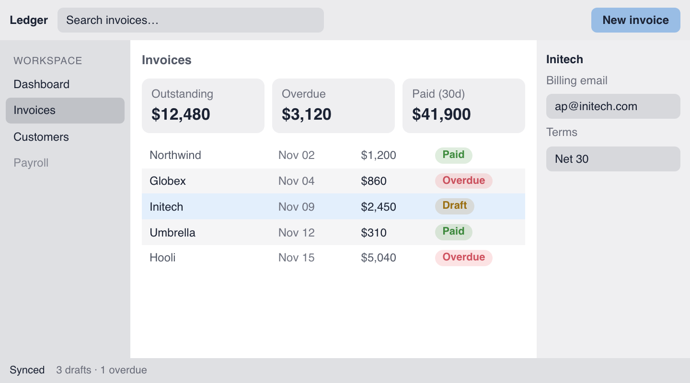
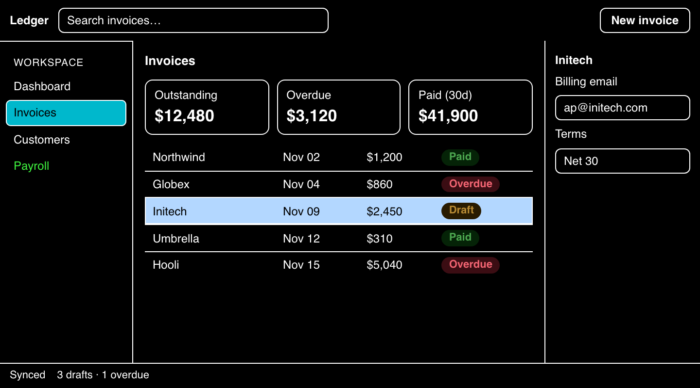

# High contrast

> **Proposal.** This describes the API as if it were implemented. None of it exists yet. The pictures come from a prototype that runs the real `huet/core` solver from `master` and fakes the proposed behavior on top. Use these pages to judge whether the API is small enough.

Huet handles three requests from the user's system:

| Request | Who picks the colors | What you do |
| --- | --- | --- |
| `prefers-contrast: less` | You | Set `contrast` below 1 |
| `prefers-contrast: more` | You | Set `contrast` above 1 |
| `forced-colors: active` | The user's OS | Nothing. Huet maps to system colors |

| Normal (`contrast: 1`) | More (`contrast: 2`) | Forced colors |
| --- | --- | --- |
|  |  |  |

In "more," fills that only marked off regions fade, and 1px lines take their place. Text moves toward black. The selected row and the current nav item keep their fills and gain an outline. In forced colors, everything uses the user's palette, and the same lines are drawn in `CanvasText`.

## The whole API

| Addition | Kind | Use it when |
| --- | --- | --- |
| `contrast` from 0 to 2 (today 0 to 1) | `createTheme` option | Always. Map it from the user's preference |
| `huet-split` | Class | A container's children tile edge to edge (app shell, panes, table rows) |
| `huet-role-state`, `huet-role-data` | Classes | Rarely. Only when ARIA can't say what a fill means |
| `{ audit: true }` | `mountTheme` option | In tests. It turns risky patterns into errors |

That's everything. Huet works out the rest:
- **Lines** from the fills you already wrote.
- **Roles** from ARIA attributes and element types.
- **Forced-colors output** from CSS in `huet/styles.css`.

## Quick start

```html
<div id="app" class="huet-split">
  <header class="huet-bg-6">…</header>
  <div class="huet-split grid grid-cols-[136px_1fr_160px]">
    <nav class="huet-bg-10">
      <a href="/invoices" aria-current="page" class="huet-bg-12">Invoices</a>
    </nav>
    <main>
      <div class="huet-split" role="grid">
        <div role="row">…</div>
        <div role="row" class="huet-bg-3">…</div>
        <div role="row" class="huet-bg-blue-12" aria-selected="true">…</div>
      </div>
    </main>
    <aside class="huet-bg-5">…</aside>
  </div>
  <footer class="huet-bg-10">…</footer>
</div>
```

```ts
import { createTheme, mountTheme } from "huet/core";

const options = { dark: "#1b2233", background: 1 };
const preference = () =>
  matchMedia("(prefers-contrast: more)").matches ? 2 :
  matchMedia("(prefers-contrast: less)").matches ? 0.9 : 1;

const colors = mountTheme(app, createTheme({ ...options, contrast: preference() }));
for (const query of ["(prefers-contrast: more)", "(prefers-contrast: less)"])
  matchMedia(query).addEventListener("change", () =>
    colors.update(createTheme({ ...options, contrast: preference() })));
```

## Rules to remember

These are written for both people and coding agents.

1. **Use ARIA for state.** A selected row has `aria-selected="true"`, and the current page link has `aria-current="page"`. Huet reads those attributes to keep state fills visible. Don't toggle a fill class alone.
2. **Put `huet-split` on any container whose children tile.** Without it, Huet treats every filled child as an island and outlines all of them.
3. **Leave borders on split children to Huet.** In high-contrast modes, Huet owns the 1px start edge of each split child.
4. **Never pick colors for high contrast yourself.** Not in `@media (prefers-contrast)`, and not in `@media (forced-colors)`. Huet already handles both.
5. **Run your browser tests with `{ audit: true }`** at every breakpoint. Errors tell you exactly what to change.

## Pages

- [Contrast levels](contrast.md): what `contrast` does below and above 1.
- [Layout: `huet-split`](layout.md): where lines go, and the errors that keep them right.
- [Roles](roles.md): why some fills fade and others stay.
- [Forced colors](forced-colors.md): what Huet writes when the OS picks the colors.

## Errors at a glance

Every error names the element and says what to write instead.

| When | Message (shortened) |
| --- | --- |
| `createTheme` | `contrast must be between 0 and 2` |
| Mount | `huet-split on <div.panels>: children 2 and 3 don't touch (8px gap). Remove the gap, or remove huet-split so the children are outlined separately.` |
| Mount | `huet-split on <ul>: children wrap onto 2 lines. huet-split needs one row or one column.` |
| Mount | `huet-role-state on <div.row> has no huet-bg-N class. Roles describe fills; add the fill or remove the role.` |
| Mount | `<aside> has its own border-inline-start, but it is a huet-split child, so Huet draws that edge in high contrast. Remove the border.` |
| Audit | `<a.nav-item> changed huet-bg-0 → huet-bg-12 after mount without a state role. Add aria-current or aria-selected, or add huet-role-state.` |

## Decisions still open

The pictures assume the first choice listed in each item.

1. **When the 1px edge is reserved.** Options: only in high-contrast modes, where layout shifts once when the user changes the setting; or always, which costs 1px everywhere but never shifts.
2. **One knob or several.** `contrast` above 1 currently drives three things: ramp extension, fading region fills, and the minimum boundary contrast. Splitting them gives more control and more API.
3. **How steep `contrast` below 1 should be.** Today's fade is steep: body text is 9.1:1 at 0.95, 6.4:1 at 0.9, and 2.3:1 at 0.6. Above 1 the proposal is gentle. A log-scale fade would make the two halves match.
4. **Layout errors after mount.** A layout can break only at a size reached later. Throwing then would break the live page, so the proposal logs a `console.error` with the same message and skips lines for that container.
5. **How much region fills fade.** At `contrast: 2` they fade to half their amount. Zero fading is simpler, but leaves less room for text on mid-tone surfaces.
6. **The name `huet-split`.**
