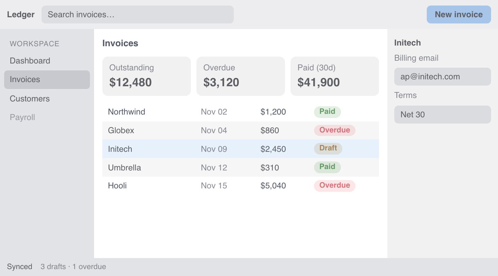
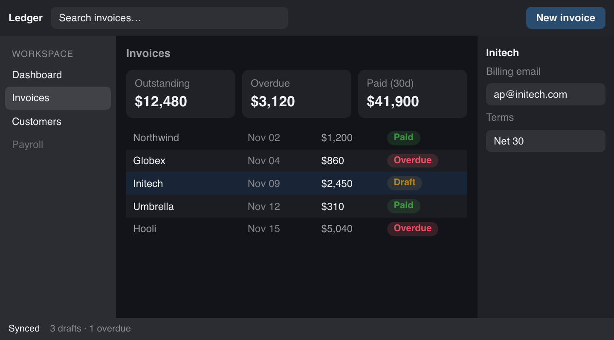
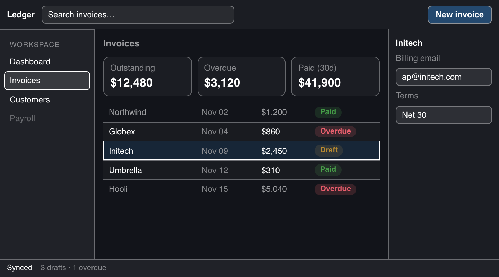

# Contrast levels

> **Proposal.** Nothing here is implemented yet. [Overview](README.md)

`contrast` is one number on the theme: 1 is your design as written, values below 1 fade it, and values above 1 strengthen it.

```ts
createTheme({ dark: "#1b2233", background: 1, contrast: 2 });
```

| `contrast: 0.9` (less) | `contrast: 1` | `contrast: 2` (more) |
| --- | --- | --- |
|  |  |  |

| Dark theme, `contrast: 1` | Dark theme, `contrast: 2` |
| --- | --- |
|  |  |

## Above 1

Raising `contrast` above 1 does three things, all in proportion:

1. **Extends the ramp.** The end of the neutral ramp opposite the background moves toward black or white. At 2 it reaches black or white. The background color stays exactly where you put it, and every class keeps its proportion: `text-55` is still 55% of the way.
2. **Fades region fills.** Fills whose only job is marking off an area, such as panels, cards and zebra rows, fade toward their parent. At 2 they're at half their amount. State, control and data fills don't fade. See [Roles](roles.md).
3. **Requires every boundary to be visible.** Each boundary between two fills must reach `1 + 2 × (contrast − 1)`, which is 3:1 at 2. Where a fill doesn't reach that, Huet draws a **1px** line whose color is solved against both sides. Lines never get thicker. Only their color changes.

Measured with the real solver. The background stays fixed, and the opposite end moves all the way at `contrast: 2`:

| Theme | Body text (`text-100`) | Muted text (`text-55`) |
| --- | --- | --- |
| Default light | 15.9 → 21.0 | 4.60 → 5.41 |
| Dark | 16.6 → 18.4 | 4.72 → 4.98 |
| Soft / paper (`#4a4f5c`–`#f4f1ea`) | 7.3 → 18.6 | **2.98 → 5.01** |
| Sunset (navy → yellow, HCL) | 11.2 → 14.5 | 3.80 → 4.39 |

Narrow, soft themes gain the most. Sunset shows the limit of a fixed background: navy against pure white is only 14.5:1, so muted text stays under 4.5:1 unless the background is allowed to move.

## Below 1

Below 1 is today's `contrast` option, unchanged. It fades every color toward its background, and it's steep:

| `contrast` | 1 | 0.95 | 0.9 | 0.8 | 0.6 |
| --- | --- | --- | --- | --- | --- |
| Body text | 15.9 | 9.1 | 6.4 | 4.0 | 2.3 |
| Muted text | 4.60 | 3.89 | 3.40 | 2.68 | 1.88 |

Use **0.9** for `prefers-contrast: less`. Anything lower makes body text hard to read.

## Choosing the value

Huet doesn't read the system preference itself. Map it in the place where you already create the theme (see [Quick start](README.md#quick-start)).

| System preference | `contrast` |
| --- | --- |
| none | 1 |
| `prefers-contrast: less` | 0.9 |
| `prefers-contrast: more` | 2 |
| `forced-colors: active` | Any value. The OS palette replaces the colors |

You can also expose `contrast` as an in-app slider, the same way apps expose zoom.
