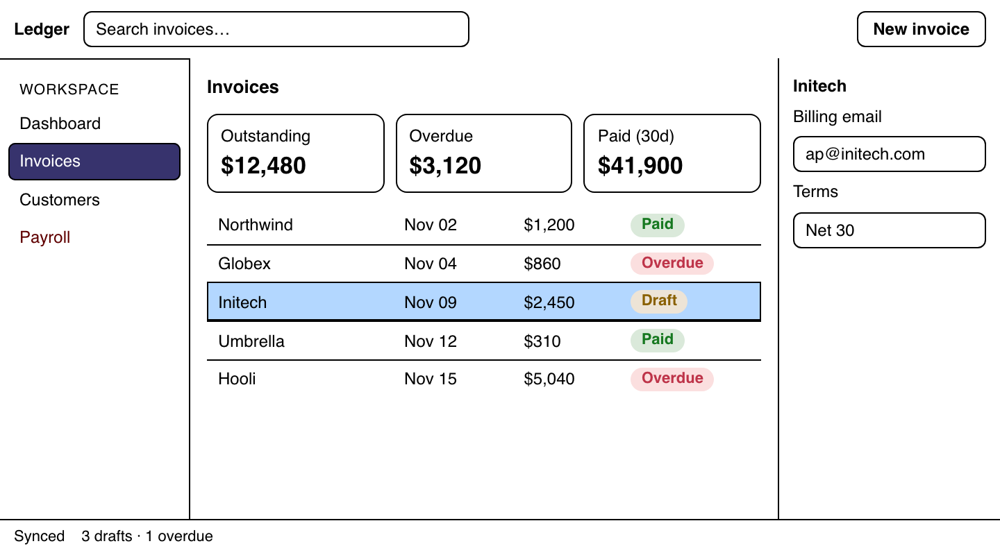

# Forced colors

> **Proposal.** Nothing here is implemented yet. [Overview](README.md)

In `forced-colors: active` (for example, Windows contrast themes), the user's OS picks a small palette of system colors. The browser rewrites author colors to fit it. **You don't write anything for this mode.** Huet's stylesheet maps each role to a system color, and the layout and role information from the other pages supplies the structure.

| Dark palette | Light palette |
| --- | --- |
|  |  |

## What Huet maps

| Element | System colors |
| --- | --- |
| Surfaces (all grouping fills) | `Canvas`, `CanvasText` |
| Split lines and island outlines | `CanvasText` |
| Inputs and buttons | `Field` / `ButtonFace`, with an outline |
| Selected (`aria-selected`) | `SelectedItem`, `SelectedItemText`, plus an outline |
| Current (`aria-current`) | `Highlight`, `HighlightText` |
| Disabled (`aria-disabled`) | `GrayText` |
| All text amounts, muted included | `CanvasText` |
| `huet-role-data` | Solved inside the palette (below) |

Huet writes system-color **keywords**, not hex values. Keywords pass through forcing, even inside CSS variables. They also follow the user's theme when it changes, without any JavaScript.

Two things Huet handles that you'd otherwise hit:

- **Shadows disappear.** The browser drops `box-shadow` in this mode, which is why every Huet line is a border or an outline.
- **Text behind a backplate disappears.** Chromium paints a `Canvas`-colored backplate behind text. That hides `HighlightText` on `Highlight` (for example, black text on the current nav item vanishes). Huet sets `forced-color-adjust: none` on state elements, so the pair renders as intended.

## Data colors in the user's palette

Status tags must stay distinguishable, so `huet-role-data` opts out of forcing. Huet reads the active palette with `getComputedStyle`, then runs the normal solver with `Canvas` and `CanvasText` as the ramp's endpoints. The tags in the pictures are that output: the same red, green and yellow anchors, fitted to a black or white page.

Huet uses tints only for data. Everywhere else it sticks to the user's colors, because they chose that palette deliberately.

## Testing

```ts
await page.emulateMedia({ forcedColors: "active", colorScheme: "dark" });
```

Chromium emulates two fixed palettes. A real Windows machine uses the user's own palette (such as Aquatic, Desert or Night sky). Behavior there has not been verified yet:
- Chromium's emulation reports `Highlight` as partly transparent (alpha 0.8). That may not happen on Windows.
- It isn't known whether switching directly between two contrast themes fires a media-query change event. Keywords update either way, but data colors read through JavaScript might not.
