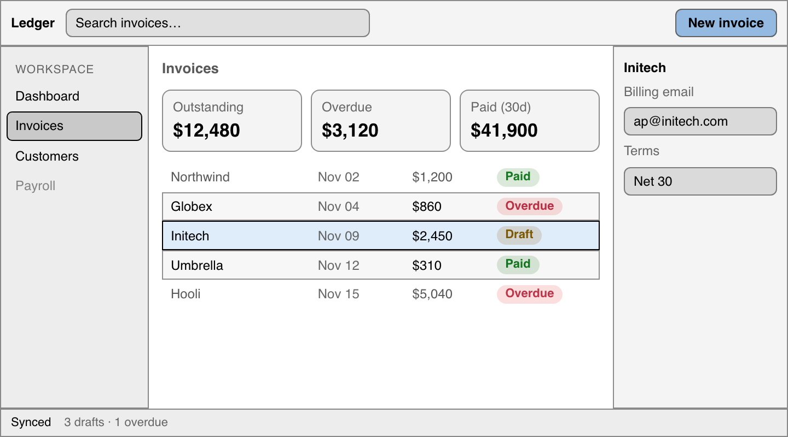

# Layout: `huet-split`

> **Proposal.** Nothing here is implemented yet. [Overview](README.md)

At `contrast` above 1, every boundary between two fills needs to be visible. Huet already knows each element's fill. It doesn't know which elements touch. `huet-split` tells it.

| With `huet-split` | Without `huet-split` |
| --- | --- |
|  |  |

Without the hint, every filled element is treated as an island and gets its own outline. That produces doubled lines where the top bar meets the sidebar, lines along the window edge, and zebra rows drawn as stacked boxes.

## What `huet-split` means

`huet-split` on a container means **"my children tile edge to edge."** That's all. You don't say which direction:

- **The direction is measured.** Huet reads the children's positions on each resize of the container, so side-by-side on desktop and stacked on mobile both work. So do `row-reverse`, grid `order`, and right-to-left layouts.
- **Lines go between neighbors only.** Each child that follows another draws its start edge. The container's outer edges belong to whatever contains it.
- **Unfilled children pass through.** In the shell above, `<main>` has no fill, so the top bar's line is solved separately against the sidebar, the main area and the inspector.
- **Nesting is fine.** The app shell, the three panes, and the table rows are three nested splits.

`huet-split` is layout-neutral. Put it next to your own `flex` or `grid` classes.

## Islands

Any filled element whose parent isn't a `huet-split` is an island: a card, an input, a button, the current nav item. In high contrast, an island gets a 1px outline drawn inside its edge (`outline-offset: -1px`). It follows `border-radius` and takes no layout space. While the island is focused, your focus ring replaces it.

## The 1px edge

Lines on split children are real borders (`border-inline-start` / `border-block-start`). Only borders survive forced colors, and logical edges handle right-to-left layouts. The width is reserved only when a high-contrast mode is active. Normal mode has no extra pixel, and the layout shifts once when the user changes the setting. Reserving it always is an [open decision](README.md#decisions-still-open).

## Errors

`huet-split` fails loudly when its children don't actually tile:

```
huet-split on <div.panels>: children 2 and 3 don't touch (8px gap at width 500px).
Remove the gap, or remove huet-split so the children are outlined separately.

huet-split on <ul.tags>: children wrap onto 2 lines at width 500px.
huet-split needs one row or one column; remove huet-split or stop wrapping.

huet-split on <div.toolbar>: child 3 is absolutely positioned.
Move it out of the split, or remove huet-split.
```

These are thrown at mount. A layout can also break later, at a size you resize to. Throwing then would break the live page, so Huet logs the same message with `console.error` and draws no lines for that container. [Open decision](README.md#decisions-still-open).

## Testing every breakpoint

The check only sees layouts that actually render. Mount once per breakpoint in a browser test:

```ts
for (const width of [390, 768, 1280]) {
  test(`layout tiles at ${width}px`, async ({ page }) => {
    await page.setViewportSize({ width, height: 900 });
    await page.goto("/?huetAudit=1"); // the app passes { audit: true } to mountTheme
    // Any huet-split or role error fails the page load.
  });
}
```
