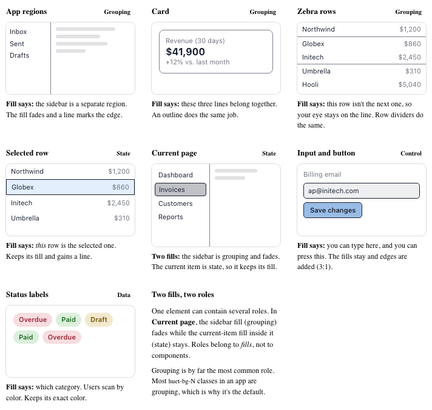
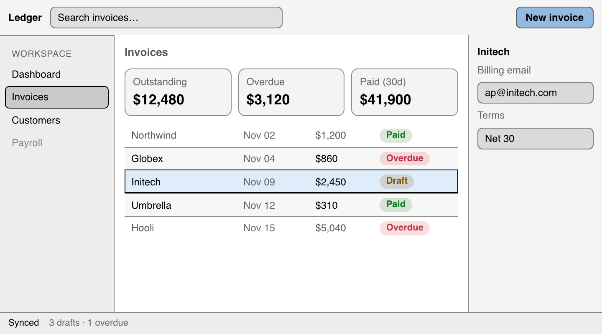

# Roles

> **Proposal.** Nothing here is implemented yet. [Overview](README.md)

In high contrast, some fills may fade and others must stay. A fill's **role** decides which. You rarely write a role yourself: Huet works it out from your HTML.

| Role | Example | `contrast` above 1 | Forced colors |
| --- | --- | --- | --- |
| **Grouping** (default) | Sidebar, card, zebra row, toolbar | Fades; a line takes over | `Canvas` + `CanvasText` line |
| **Control** | `input`, `button` | Keeps its fill; edge at least 3:1 | `Field` / `ButtonFace` + outline |
| **State** | Selected row, current page | Keeps its fill; strong outline | `SelectedItem` / `Highlight` |
| **Data** | Status tags, chart colors | Keeps its exact hue | Solved inside the user's palette |

**Grouping** means the fill's only message is "this area is separate." A simple test: if replacing the fill with a thin line loses nothing else, it's grouping. If you'd also lose *which one is selected*, *that you can type here*, or *which category this is*, it isn't.



## How Huet decides

Huet checks these in order, for each element with a `huet-bg-*` class:

1. **`huet-role-data` or `huet-role-state`** on the element → that role.
2. **A native control** (`input`, `select`, `textarea`, `button`, `[role=button]`) → control.
3. **`aria-selected`, `aria-current`, `aria-pressed` or `aria-checked`** on the element, or on an ancestor before the next filled element → state.
4. **Anything else** → grouping.

There are no other heuristics. Huet writes the result onto the element so you can inspect it: `data-huet-role="state"`.

## When ARIA is missing

The common mistake is toggling a fill class alone:

```html
<!-- Huet can't tell this is the selection -->
<div role="row" class="huet-bg-blue-12">Initech …</div>

<!-- Correct: the fill is state, and screen readers learn it too -->
<div role="row" class="huet-bg-blue-12" aria-selected="true">Initech …</div>
```

| With `aria-selected="true"` | Without it |
| --- | --- |
|  |  |

Without the attribute, the selected row is treated as grouping. It fades to a faint tint, and only the row lines are left to mark it.

Huet already watches class changes. With `{ audit: true }`, a fill that changes after mount and has no state role is an error:

```
<div.row> changed huet-bg-0 → huet-bg-blue-12 after mount without a state role.
In high contrast this fill fades. Add aria-selected (or aria-current / aria-pressed)
to this element, or add huet-role-state.
```

## When to write a role class

Only when ARIA can't describe the fill:

- `huet-role-state`: a state with no ARIA equivalent, such as a highlighted search match.
- `huet-role-data`: color that carries information, such as status tags or a color legend. Data fills also keep their hue in forced colors.

A role class needs a fill on the same element. Without one it's an error, because roles describe fills, not components.

## Judgment calls

| Fill | Role |
| --- | --- |
| Table header band, code block, quoted text | Grouping |
| Modal or popover surface | Grouping (it gets an outline in high contrast) |
| Unread message row | State: add `aria-current`, or the bold or dot you show anyway |
| Hover background | Not handled. `:hover` is CSS, which Huet can't see |
| Info or warning callout tint | Grouping if the text or an icon says "Warning." Data if color is the only signal |
