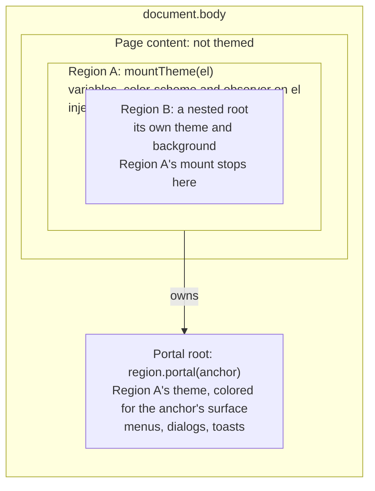

# Scoping Huet: proposal

Huet's core already works on one element, so most of the work is three core gaps and rewriting the shadcn adapter, which themes the whole page by design. Nothing is built yet; this proposal needs a decision first.

## What blocks scoping today

Three core gaps block scoping. Nearly everything that touches the page outside the region is in the shadcn adapter. Line numbers are as of commit 35dca81.

| Where | What reaches outside the region | Impact |
| --- | --- | --- |
| `packages/huet/src/core/dom.ts:40` | `mountTheme` throws if one root is inside another, so nested themed regions are impossible | Blocker |
| `dom.ts` | No portal support: a menu on `document.body` needs a separate mount, colored against the page background instead of the surface it opened from | Blocker |
| `dom.ts` | `color-scheme` is never set, so scrollbars, date pickers and autofill in a dark region on a light page stay light | Gap |
| `core/tailwind.css:7` | `@theme { --color-*: initial; }` deletes the host's whole Tailwind palette | Blocker for Tailwind hosts |
| `core/css.ts:36` | `themeCss` writes to `:root` unless given a `selector` | Default only |
| `core/forms.css:12` | `@layer base, components;` sets the page's cascade layer order | Minor |
| `images.ts`, `svgs.ts` | Nested mounts would recolor the same images twice; canvases use the global `document` | Minor |
| `core/shiki.ts` | None: tokens read `var(--huet-*)` from the nearest surface | Already scoped |
| `huet-react` | No component applies a theme to a subtree; the configurators only edit one | Gap |
| `persistentState.ts:20`, `:134` | Fixed `huet:*` localStorage keys shared by every configurator; `reset()` reloads the whole window | Minor |
| `configurator.css:18` | `@theme` probably compiles to `:root, :host { --hc-* }` (not verified with a build) | Minor |
| shadcn adapter `:54`, `:66`, `:375` | Role variables, `--color-*` swatches, background, `.dark` and `colorScheme` set on `<html>` | Global by design |
| shadcn adapter `:196`, `:638`, `:667`, `:794`, `:811`, `:833`, `:913` | Six injected `<style>` elements with `.dark:not(html)`, `.theme-*`, `:root`/`html`/`.dark` chart rules, `[data-chart]`, bare `header` and `:root` code variables | Global by design |
| shadcn adapter `:396`, `:754`, `:872`, `:1023` | Observers on `document.head` and `document.body` | Global by design |
| shadcn adapter `:1027`, `:1040` | `mountImages` and `mountSvgs` on `document.body`; every `` gets new `loading` and `crossOrigin` | Global by design |
| shadcn adapter `:1051`, `:1127` | One fixed `huet-shadcn` key and a window-wide `storage` listener | Global by design |
| shadcn components | Radix portals render to `body` and are themed only because variables sit on `<html>` | Blocker |

The shadcn adapter is `scripts/shadcn-huet/huet-configurator.tsx`.

## Recommended design

A themed region is a root element: everything Huet writes goes on that element, its subtree or a portal root it owns.

1. **Nested roots are boundaries.** Drop the error for nested roots. An outer mount skips elements whose nearest `[data-huet-root]` isn't its own root, and the inner mount owns its subtree with its own theme and background. CSS variables inherit, so the inner root's values override the outer ones. `mountImages` and `mountSvgs` follow the same rule.
2. **Each region sets its color scheme.** `mountTheme` writes `color-scheme` and `data-huet-scheme="dark|light"` on the root, and on any surface whose polarity flips. Polarity is the end of the ramp text reads better against, measured with APCA.
3. **Portal roots belong to the mount.** `region.portal({ anchor? })` returns a `
` on `root.ownerDocument.body`. The region themes, updates and removes it. With an `anchor`, its surface is the anchor's current `--huet-background`, so a menu opened from a dark card gets dark-card colors. `ConfiguratorPortal` already works this way.
4. **CSS stops touching the page.** `huet/tailwind.css` no longer clears the palette; sites that want only Huet colors add `@theme { --color-*: initial; }` themselves. `themeCss` requires a `selector` (cheap to change at 1.0.0-alpha.1). `forms.css` drops its layer-order statement.
5. **React gets a region component.** `<HuetRoot theme background images svgs as="div">` mounts on its own element and renders a scoped `themeCss` `<style>` for server rendering. `useHuetPortalContainer()` returns its portal root. Nested `<HuetRoot>`s work through rule 1. The configurator gets a `storageKey` prop, and `reset()` re-reads state instead of reloading.
6. **shadcn becomes `mountShadcnTheme(container, theme, opts)`.**
    - Variables go inline on the container and its portal roots. shadcn v4's `@theme inline` reads `var(--background)` at each element, so this reaches every utility; non-inline setups also need the `--color-*` aliases.
    - `.dark` goes on the container; shadcn's `&:is(.dark *)` variant matches its descendants.
    - Injected rules are wrapped in `@scope ([data-huet-region="id"]) to ([data-huet-region])`, which stops them at nested regions. The `header` rule becomes the container's background, and the `:root` code variables go inline.
    - Observers, `mountImages` and `mountSvgs` run on the container. Storage uses a per-region key.
    - Each `*Primitive.Portal` takes `container={useHuetPortalContainer()}`. shadcn components are the site's own source, and `integration.patch` already patches them.

## How the pieces fit

Region A's portal root sits on `body`, outside the page, but shares A's theme. Region B keeps its own theme, and A's mount and scoped rules stop at its edge.

## Trade-offs

- **Portal on `body` vs inside the region.** On `body`, popups position correctly and escape the region's stacking context, but each portal needs wiring and copies the anchor's colors when it opens. Inside the region they inherit for free, but `transform`, `contain` or `z-index` on the region break dialogs and fixed popovers.
- **Tailwind's `dark:` can't be scoped cleanly.** `&:is(.dark *)` matches any dark ancestor, so a light region on a dark page still matches `dark:` utilities. `:not(.dark .light *)` fixes one level of nesting. Style queries (`@container style(--huet-scheme: dark)`) handle any depth but need a Firefox check. Document this for now.
- **`@scope` vs compound selectors.** `@scope` is clean and its `to (...)` limit handles nesting, but needs a recent browser (Firefox shipped it in late 2025). Prefixing selectors with `[data-huet-region="id"]` works everywhere but raises specificity and can't exclude nested regions.
- **Variants stop at boundaries.** `group-hover` on an element outside an inner root doesn't recolor inside it, because the inner region doesn't inherit the outer one's background states.
- **Some CSS stays global but inert.** `.huet-*` classes and `@utility huet-*` only match Huet's own names. Shadow DOM would isolate fully, but Radix portals leave the shadow root and Tailwind must be adopted into it, so it isn't the default.

## Open decisions

- [ ] Portals: a body-level portal root per region with an `anchor` option (recommended), or portals inside the region?
- [ ] Tailwind palette: make `huet/tailwind.css` stop clearing it (breaking), or add a separate entry that doesn't?
- [ ] shadcn: turn the adapter into a reusable `mountShadcnTheme`, or keep it a demo script that can be scoped?
